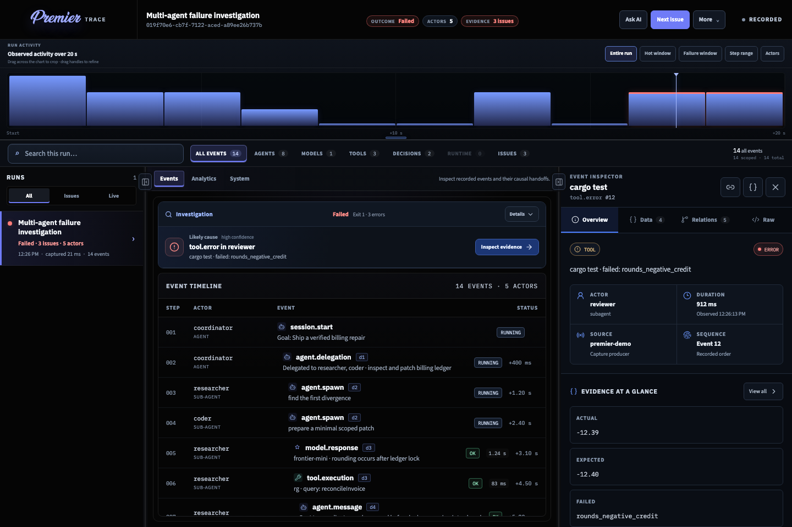

# Premier

Premier is a local-first **agent reporter**: a single PATH-installable binary that records process + typed multi-actor evidence and opens a self-contained investigation viewer.

It captures terminal activity and accepts typed runtime events for agents, subagents, delegation, model calls, tools, approvals, messages, joins, and framework-specific payloads. Every event can carry actor identity, causal parents, spans, cross-links, correlation IDs, status, duration, and structured payloads.



## Install (production)

Install the script-free npm launcher globally:

```sh
npm install --global @premierstudio/premier
premier --version
```

The launcher selects a platform-specific native package and runs its embedded
viewer binary. Neither the launcher nor the platform packages define lifecycle
scripts or perform install-time downloads, so npm 12 requires no
`allowScripts` exception. Packages are published through GitHub Actions OIDC
trusted publishing with provenance.

Pin Premier to one repository when reproducibility matters:

```sh
npm install --save-dev @premierstudio/premier
npx premier record -- npm test
```

For typed JavaScript or TypeScript instrumentation:

```sh
npm install @premierstudio/trace
```

Verify:

```sh
premier --version
premier demo
premier open .premier/traces/multi-agent-demo.atrace
```

The viewer is **embedded** in the binary. You do not need this repository or
`apps/viewer/dist` at runtime.

### Signed archive alternative

GitHub releases also provide native archives with per-asset Sigstore bundles.
The archive installer accepts local paths only and verifies the pinned release
workflow identity before extraction:

```sh
./scripts/install.sh \
  --archive ./premier-0.1.0-aarch64-apple-darwin.tar.gz \
  --signature-bundle ./premier-0.1.0-aarch64-apple-darwin.tar.gz.sigstore.json
```

### Update, version check, and uninstall

For npm installations:

```sh
npm update --global @premierstudio/premier
npm uninstall --global @premierstudio/premier
```

Archive lifecycle scripts live in this repository's `scripts/` directory (they
are not packed into the release archive). From a Premier checkout they accept
explicit local paths and support review before a change:

```sh
./scripts/version-check.sh --archive ./dist/premier-0.1.1-aarch64-apple-darwin.tar.gz
./scripts/update.sh --archive ./dist/premier-0.1.1-aarch64-apple-darwin.tar.gz --dry-run
./scripts/update.sh --archive ./dist/premier-0.1.1-aarch64-apple-darwin.tar.gz
./scripts/uninstall.sh --prefix "${CARGO_HOME:-$HOME/.cargo}" --dry-run
./scripts/uninstall.sh --prefix "${CARGO_HOME:-$HOME/.cargo}"
```

Uninstall removes only the exact `<prefix>/bin/premier` file. See
[`docs/releasing.md`](docs/releasing.md) for reproducible packaging and the
supported target matrix.

### Alternative: cargo only (after viewer build)

```sh
npm install && npm run build
cargo install --path crates/premier-cli --locked --force
```

## Quick start (after install)

```sh
# richest first investigation surface
premier demo
premier open .premier/traces/multi-agent-demo.atrace

# record any command (stdout/stderr always captured)
premier record -- npm test
premier record --open --name "Billing repair" -- your-agent run

# Unix: give interactive/TUI commands a real terminal and preserve their
# stdout/stderr ordering as one terminal stream
premier record --pty -- your-agent run

# list / verify
premier list
premier verify .premier/traces/<id>.atrace

# encrypt a finalized legacy trace, or rotate an encrypted trace to a new key
premier encrypt .premier/traces/<id>.atrace --new-key-file /run/secrets/premier/trace.key

# assign a legacy local trace to an immutable shared tenant
premier claim .premier/traces/<id>.atrace --tenant acme

# investigate, compare, and export without starting the viewer
premier query .premier/traces/<id>.atrace --kind tool.error --json
premier diff .premier/traces/baseline.atrace .premier/traces/current.atrace
premier export .premier/traces/<id>.atrace --output evidence.json
```

Structured event payloads are redacted **before they are written to the active
journal**. Premier recursively replaces common credential fields (including
password, secret, token, API-key, authorization, and cookie variants) with
`[REDACTED]`. Add product-specific field names with repeatable
`--redact-field` options:

```sh
premier record --redact-field customer_pin --redact-field signing_material -- your-agent run
```

Terminal output remains visible and is stored raw by default, because Premier
cannot safely infer secrets in arbitrary text. To redact only persisted terminal
evidence while keeping the live terminal display raw, provide repeatable exact
literals and/or regular expressions:

```sh
premier record \
  --redact-literal "$ONE_TIME_SECRET" \
  --redact-regex 'Bearer [A-Za-z0-9._-]+' \
  -- your-agent run
```

The manifest records that structured redaction was active, non-sensitive custom
field names, and terminal-pattern counts. It never records configured literal
values. Review traces before sharing: secrets in unlabelled structured strings
or unmatched terminal text cannot be detected reliably.

### Interrupted recordings

Premier preserves normal exits and Unix signal termination separately in the
trace manifest and `process.exit` event. The existing manifest `exit_code`
remains shell-compatible (`128 + signal`) for older consumers. On Unix,
`premier record` handles recorder-level `SIGINT` and `SIGTERM`, forwards the
signal to the recorded child, waits for it to exit, finalizes the trace, and
returns the shell-compatible status (`130` for `SIGINT`, `143` for `SIGTERM`).

An uncatchable `SIGKILL`, machine loss, or recorder crash can still prevent
finalization. Complete frames remain in `active.events.pb`; after the trace has
been idle for five minutes, recover it safely with:

```sh
premier recover .premier/traces/<id>.atrace
```

Recovery refuses recently modified traces by default, never rewrites a trace
whose manifest is already finalized, discards only a torn trailing frame, adds
a `session.interrupted` evidence event, and produces a verifiable journal. Use
`--stale-after-seconds` to change the idle threshold. `--force` is intended only
for a trace you have independently confirmed is no longer being recorded. A
recorder lease heartbeat keeps silent-but-live runs fresh, so the idle guard is
not dependent on the child producing events.

### Interactive and TUI recording

Pipe capture remains the default and is backward compatible: stdin is inherited,
while stdout and stderr are recorded separately as `process.stdout` and
`process.stderr`. On Unix, opt into PTY capture for interactive shells and full
screen terminal applications:

```sh
premier record --pty -- claude
```

`--pty` gives the child a controlling pseudo-terminal, mirrors the parent
terminal size (falling back to `LINES`/`COLUMNS`, then 24×80), temporarily puts
an interactive parent terminal into raw mode, and forwards input and recorder
signals to the PTY process group. Because a terminal merges stdout and stderr,
Premier records their exact observed byte order as `process.terminal` events
instead of claiming separate streams. Valid multi-byte UTF-8 is preserved across
read boundaries. The `session.start` payload records PTY mode and dimensions,
and the manifest advertises `terminal.pty` and `terminal.merged-output`.

PTY capture currently requires Unix. On other platforms `--pty` exits with an
explicit unsupported-mode error before creating a trace; omit it to use the
portable pipe recorder.

### Native provider adapters

When a recognized agent CLI already requests its structured JSONL output,
`premier record` (default `--adapter auto`) normalizes that stream into typed
agent, model, tool, and approval evidence without hand-written emitters:

```sh
premier record --adapter auto -- codex exec --json "review this repository"
premier record --adapter claude -- claude -p --output-format stream-json "review this repository"
```

Seven providers are supported: `codex` (detected with `--json`), `claude`,
`gemini`, and `kimi` (`--output-format stream-json`), `grok`
(`--output-format streaming-json`), `opencode` (`--format json`), and `droid`
(`--output-format json` or `-o json`). Each normalized event records
`source=adapter.<provider>.v1` and keeps the complete native object under
`payload.native`; malformed or oversized JSONL lines become
`adapter.diagnostic` events instead of silently disappearing. Use an explicit
`--adapter <provider>` when a wrapper renames the executable, or
`--adapter none` when the JSON stream is application output rather than agent
evidence. Native adapters require pipe capture and are rejected with `--pty`.

## Emit typed agent evidence

While a process runs under `premier record`, Premier injects:

| Variable | Purpose |
| --- | --- |
| `PREMIER_TRACE_ID` | Active trace id |
| `PREMIER_COLLECTOR_URL` | Local loopback event endpoint |
| `PREMIER_COLLECTOR_TOKEN` | Per-recording bearer token (never written into the trace) |

### CLI emitter

```sh
premier record -- sh -c '
  premier emit --kind agent.spawn --actor researcher --actor-type subagent --status running \
    --payload "{\"task\":\"find the first divergence\"}"
'
```

Or raw JSON:

```sh
echo '{"kind":"tool.execution","actor_id":"coder","status":"ok","payload":{"tool":"rg"}}' \
  | premier emit --json -
```

### JavaScript / TypeScript SDK

```sh
npm install @premierstudio/trace
# or from a checkout: npm install ./sdk/js
```

```ts
import { emit, premier, isPremierActive } from "@premierstudio/trace";

if (isPremierActive()) {
  await premier.spawn("researcher", { task: "find the first divergence" });
  await premier.model("researcher", {
    provider: "openai",
    model: "gpt-5",
    usage: { input_tokens: 1200, output_tokens: 400, total_tokens: 1600 },
    response: "…",
  });
  await emit({
    kind: "approval.request",
    actor_id: "coder",
    status: "pending",
    payload: { operation: "write", files: ["src/billing/ledger.ts"] },
  });
}
```

### Shell fallback

```sh
./sdk/shell/premier-emit.sh '{"kind":"agent.spawn","actor_id":"researcher","actor_type":"subagent","status":"running"}'
```

### curl

```sh
curl -X POST "$PREMIER_COLLECTOR_URL" \
  -H "Authorization: Bearer $PREMIER_COLLECTOR_TOKEN" \
  -H "Content-Type: application/json" \
  --data '{
    "kind": "agent.spawn",
    "actor_id": "researcher",
    "actor_type": "subagent",
    "span_id": "research",
    "parent_span_id": "coordinator-turn-4",
    "status": "running",
    "payload": { "task": "find the first divergence" }
  }'
```

The collector only binds to loopback, requires an unguessable per-recording bearer token, limits event bodies, and never writes the token into the trace.

## Local evidence workflows

These commands read local `.atrace` directories directly; they do not start a
server or send evidence over the network.

Filter evidence by exact kind, actor, or status and optionally search event
metadata and payload text. Output is bounded to 100 events by default and 1000
at most:

```sh
premier query run.atrace --actor reviewer --status error --search invoice
premier query run.atrace --kind model.response --limit 250 --json
```

Export a portable JSON evidence document to stdout or a file. Export decodes
each structured payload and recursively replaces common secret fields—including
passwords, API keys, authorization headers, access tokens, client secrets, and
secret access keys—with `[REDACTED]`. Always review an export before distributing
it because secrets embedded in unlabelled free-form strings cannot be identified
reliably.

```sh
premier export run.atrace > evidence.json
premier export run.atrace --output evidence.json
```

Compare two traces by semantic event identity. Generated trace, event, span,
correlation, and timestamp values are ignored; status, source, actor type,
duration, and structured payload changes remain visible:

```sh
premier diff baseline.atrace current.atrace
premier diff baseline.atrace current.atrace --json
```

`replay` is deliberately an evidence playback tool, not an execution engine. It
prints recorded events as JSON lines in sequence order and reproduces recorded
timing, but never invokes the original command, model, tool, or agent:

```sh
premier replay run.atrace --speed 4
premier replay run.atrace --no-sleep
```

### Model usage evidence

For token, cost, and prompt attribution, emit model evidence with the provider's exact usage response and the context your runtime actually sent. Premier keeps roles separate and never estimates missing role-level tokens:

```json
{
  "kind": "model.response",
  "actor_id": "researcher",
  "actor_type": "subagent",
  "payload": {
    "provider": "openai",
    "model": "gpt-5",
    "system_prompt": "Preserve evidence and cite sources.",
    "developer_prompt": "Find the first causal divergence.",
    "messages": [{ "role": "user", "content": "Why did this run fail?" }],
    "tools": [{ "name": "repo_search", "input_schema": { "type": "object" } }],
    "usage": {
      "input_tokens": 1296,
      "output_tokens": 546,
      "total_tokens": 1842,
      "input_tokens_details": { "cached_tokens": 384 },
      "output_tokens_details": { "reasoning_tokens": 212 },
      "input_tokens_by_role": { "system": 302, "developer": 238, "user": 148, "tool": 608 },
      "cost_usd": 0.0047
    },
    "response": "The first divergence occurs after the ledger lock."
  }
}
```

## Viewer

`premier open` launches the browser and focuses the requested trace. `premier serve` runs the server without opening a browser:

```sh
premier serve
# http://127.0.0.1:4317
```

Team / non-loopback binds require both native TLS and authentication:

```sh
premier serve \
  --bind 0.0.0.0:4317 \
  --tls-cert /run/secrets/premier/fullchain.pem \
  --tls-key /run/secrets/premier/private-key.pem \
  --auth-config /run/secrets/premier/auth.json
```

Premier refuses plaintext or anonymous non-loopback startup. `--auth-config`
contains owner-only SHA-256 bearer-token hashes mapped to immutable tenant IDs
and `trace:read` / `assistant:use` scopes; raw trusted identity headers are not
accepted. Cross-tenant lookups return the same not-found response as an unknown
trace so artifact existence is not disclosed.

Remote service mode accepts encrypted traces only. Set
`PREMIER_TRACE_KEY_FILE` to an owner-only file containing exactly 64 hexadecimal
characters (a 32-byte master key). New recordings then encrypt active and final
event frames with XChaCha20-Poly1305 and place sensitive manifest fields in an
authenticated private envelope. Independent per-trace keys are derived with
HKDF; a wrong key or modified ciphertext fails closed. Existing finalized
traces can be migrated or rotated atomically:

```sh
openssl rand -hex 32 > /run/secrets/premier/trace.key
chmod 600 /run/secrets/premier/trace.key

PREMIER_TRACE_KEY_FILE=/run/secrets/premier/trace.key \
  premier record --tenant acme -- your-agent run

premier encrypt legacy.atrace --new-key-file /run/secrets/premier/trace.key

PREMIER_TRACE_KEY_FILE=/run/secrets/premier/old.key \
  premier encrypt encrypted.atrace --new-key-file /run/secrets/premier/new.key
```

Optional `--viewer-dir path/to/dist` serves assets from disk (local UI development). Production installs use the **embedded** viewer by default.

### Semantic diagnostics and large traces

Finalized manifests include advisory `diagnostics` for Premier's known event
families. Premier checks known statuses, object-shaped payloads, lifecycle
pairing, and causal links for agent spawn/result, model request/response, tool
invocation/result, approval request/decision, and delegation/join. Diagnostics
are warnings: unknown custom event kinds remain valid and do not make
cryptographically verified traces fail verification. `premier verify` prints
the warning count and evidence locations, and the trace list/detail APIs expose
the same manifest field.

The existing full events endpoint remains compatible:

```text
GET /api/traces/<trace-id>/events
```

Large clients can request a bounded, sequence-based page (maximum 10,000):

```text
GET /api/traces/<trace-id>/events?after_sequence=25000&limit=500
```

Pages retain the existing event-array response. Continue with the final event's
`sequence`. Live SSE streams tail complete frames from their last byte offset
instead of decoding the entire active journal on every poll.

## Develop from source

```sh
npm install
npx playwright install chromium
npm run build
cargo test --workspace
npm run test:all
```

```sh
# run without installing
cargo run -p premier-cli --bin premier -- demo
cargo run -p premier-cli --bin premier -- open .premier/traces/multi-agent-demo.atrace
```

## Commands

| Command | Purpose |
| --- | --- |
| `premier demo` | Seed a multi-agent investigation trace |
| `premier record -- <cmd>` | Record process I/O + local collector for typed events |
| `premier emit …` | Post a typed event to the active collector |
| `premier open [trace]` | Serve embedded viewer and open the browser |
| `premier serve` | Serve viewer without opening a browser |
| `premier list` | List traces under `.premier/traces` |
| `premier verify <trace>` | Verify integrity digests and framing |
| `premier recover <trace>` | Safely finalize an abandoned recording |
| `premier claim <trace> --tenant <id>` | Atomically assign a legacy local trace to an immutable tenant |
| `premier encrypt <trace> --new-key-file <path>` | Encrypt a finalized trace or rotate its master key |
| `premier query <trace> …` | Filter bounded local event evidence; add `--json` for structured output |
| `premier export <trace>` | Write recursively redacted portable JSON evidence |
| `premier diff <baseline> <current>` | Compare semantic event structure while ignoring generated IDs |
| `premier replay <trace>` | Replay evidence timing only; never re-execute the traced workload |

## License

Apache-2.0
